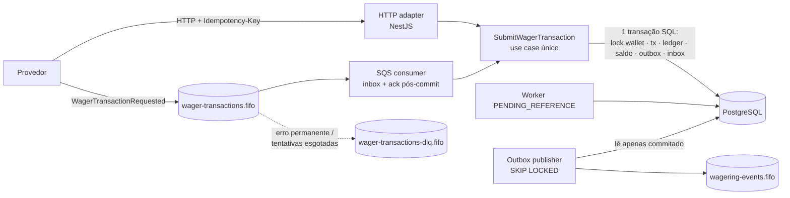
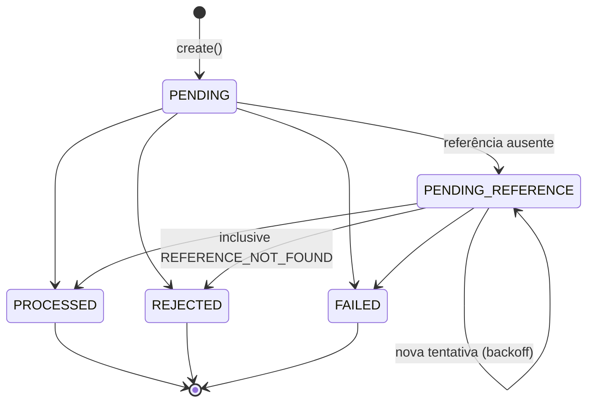

# Arquitetura — Distributed Wagering Processor

Este documento explica **o que** foi construído e **por que**, com os trade-offs aceitos e as limitações conhecidas. Cada garantia aponta para o código e para o teste que a comprova.

**Sumário**

1. [Visão geral](#1-visão-geral)
2. [Camadas e fronteiras](#2-camadas-e-fronteiras)
3. [Modelo de domínio](#3-modelo-de-domínio)
4. [Regras de negócio e interpretações adotadas](#4-regras-de-negócio-e-interpretações-adotadas)
5. [Concorrência](#5-concorrência)
6. [Idempotência](#6-idempotência)
7. [Garantias aplicadas no schema](#7-garantias-aplicadas-no-schema)
8. [ORM, mapeamento do Money e estratégia transacional](#8-orm-mapeamento-do-money-e-estratégia-transacional)
9. [API HTTP — contrato de status](#9-api-http--contrato-de-status)
10. [Processamento por SQS](#10-processamento-por-sqs)
11. [Transactional Outbox](#11-transactional-outbox)
12. [Referências fora de ordem](#12-referências-fora-de-ordem)
13. [Observabilidade](#13-observabilidade)
14. [Autenticação](#14-autenticação)
15. [Estratégia de testes](#15-estratégia-de-testes)
16. [Trade-offs e limitações](#16-trade-offs-e-limitações)
17. [Versões e cadeia de suprimentos](#17-versões-e-cadeia-de-suprimentos)

---

## 1. Visão geral

Toda instância roda os mesmos componentes: HTTP, consumidor, publisher da outbox e worker de referências. Não há líder, lock global nem afinidade de instância. **A correção vem do PostgreSQL:** lock por linha de wallet, constraints, índices únicos e triggers. Ordenação e deduplicação do SQS são só otimizações.

## 2. Camadas e fronteiras

| Camada | Conteúdo | Depende de |
|---|---|---|
| `domain/` | `Money`, `Wallet`, `WagerTransaction`, `WalletLedgerEntry`, `WagerSettlement`, eventos, inbox/outbox | nada (nem Nest, nem ORM) |
| `application/` | use cases, **portas** (`UnitOfWork`, repositórios, `EventPublisher`, `Clock`, `IdGenerator`, `Metrics`, `Logger`) | `domain` |
| `infrastructure/` | adapters: MikroORM (UoW, repositórios, migrations), SQS, Prometheus, logger JSON | `application`, `domain` |
| `interfaces/` | HTTP (controllers NestJS) e consumidor SQS: **adaptadores finos** que chamam o mesmo use case | `application` |
| `bootstrap/` | configuração e *composition root* ([container.ts](src/bootstrap/container.ts)), compartilhado por app, workers e testes | todas |

- **Modelagem (seção 6.0 do enunciado):**
  - construtores `private`;
  - factories `create`/`open`/`opening`/`receive`/`enqueue`;
  - `rehydrate`, que reconstrói o estado sem revalidar as transições.
- **Regras isoladas:** todas as regras da seção 7 ficam num **serviço de domínio puro** ([wager-settlement.ts](src/domain/wagering/wager-settlement.ts)), sem I/O e testado só com testes de unidade. O use case apenas:
  1. carrega o estado sob lock;
  2. chama `WagerSettlement.settle`;
  3. persiste o resultado.

## 3. Modelo de domínio

### Money ([money.ts](src/domain/money/money.ts))
- **Representação:** valor interno em **`bigint` de centavos**. Não existe `number` em nenhum caminho monetário, nem no JSON: `{"amount": 25}` é recusado com 400.
- **Entrada:** só a regex `^(0|[1-9]\d*)(\.\d{1,2})?$`, ou seja, sem sinal, sem expoente, sem zeros à esquerda e com até 2 casas. `NaN`, `Infinity`, `1e3`, `-1.00`, `1.234`, `01.00` e string vazia são rejeitados.
- **Saída:** sempre com escala fixa de 2 casas (`"25"` → `"25.00"`).
- **Sem arredondamento, nunca:** mais de 2 casas é erro, não arredondamento. Isso elimina a pergunta "qual regra de arredondamento?".
- **Limite de magnitude:** `NUMERIC(20,2)` (18 dígitos inteiros). Uma operação que sairia da faixa lança `MoneyOverflowError`, e o settlement checa antes, rejeitando com `BALANCE_LIMIT_EXCEEDED`.
- **Multi-moeda:** operações entre moedas diferentes lançam `CurrencyMismatchError`. A moeda tem coluna própria e o saldo é por wallet (`player_id + currency`).

### Wallet ([wallet.ts](src/domain/wallet/wallet.ts))
- **Saldo e ledger não divergem:** o saldo só muda por `debit()`/`credit()`, e **ambos retornam o `WalletLedgerEntry`** daquela mudança. Não existe caminho no domínio que altere um sem o outro.
- **`version`:** começa em 1 e incrementa **só** quando o saldo muda; o banco também verifica isso (§7).
- **Abertura:** `open()` com saldo positivo gera o lançamento `0 → saldo inicial`, que acompanha a transação interna `OPENING`.

### WagerTransaction ([wager-transaction.ts](src/domain/wagering/wager-transaction.ts))

- **Estados terminais:** qualquer transição a partir de um estado terminal lança `InvalidTransactionStateError`. É erro de programação, por isso vira HTTP 500.
- **Saldo observado:** `balanceAfter` guarda o saldo **observado no momento da decisão**, o que permite o replay fiel (regra 7).

### WalletLedgerEntry ([wallet-ledger-entry.ts](src/domain/wallet/wallet-ledger-entry.ts))
- **Imutabilidade estrutural:** campos `readonly`, `Object.freeze` e nenhum método de transição.
- **Conferência na factory:** `create()` valida `before ± money == after`, valor positivo e saldos não negativos.
- **Double-entry:** não implementado (é opcional). O ledger é de partida simples por wallet, mas a FK composta amarra cada lançamento à sua transação (§7).

## 4. Regras de negócio e interpretações adotadas

| Kind | Efeito | Referência | Regras |
|---|---|---|---|
| `BET` | débito | proibida | Sem saldo → `INSUFFICIENT_FUNDS` |
| `WIN` | crédito | opcional, só `BET` da mesma rodada | — |
| `LOSS` | nenhum (sem lançamento) | opcional, só `BET` | Gera `WagerTransactionProcessed`, mas não `WalletBalanceChanged` |
| `REFUND` | crédito | **obrigatória**, só `BET` | Valor igual ao da referência |
| `ROLLBACK` | inverso da referência | **obrigatória**: `BET`, `WIN` ou `REFUND` | Valor igual; se deixaria o saldo negativo → `REVERSAL_INSUFFICIENT_FUNDS` |

**Interpretações que foram além do texto do enunciado:**

1. **Cada transação é revertida no máximo uma vez, somando `REFUND` e `ROLLBACK`.** O enunciado diz "uma vez pelo mesmo tipo de operação". Ler literalmente permitiria `REFUND` **e** `ROLLBACK` da mesma `BET`, ou seja, crédito em dobro. Adotei a leitura mais segura, garantida por índice único parcial (§7). Uma reversão de uma reversão (`ROLLBACK` de `REFUND`) continua permitida, porque referencia outra transação.
2. **`WIN`/`LOSS` sobre uma `BET` já revertida → `ALREADY_REVERSED`.** Pagar prêmio sobre uma aposta devolvida seria prejuízo direto.
3. **Escopo da referência:** a referência precisa ter o mesmo provider, player, wallet, moeda e rodada; senão → `REFERENCE_MISMATCH`.
4. **Estado da referência:**
   - se ainda está `PENDING`/`PENDING_REFERENCE`, a transação **continua esperando**;
   - se está `REJECTED`/`FAILED` → `REFERENCE_NOT_PROCESSED`.
5. **`playerId` diferente do dono da wallet → `PLAYER_WALLET_MISMATCH`, e o saldo NÃO é gravado nem devolvido.** Caso contrário, um provider descobriria o saldo de outro jogador.
6. **O que não é persistido:**
   - **wallet inexistente** → 404 `WALLET_NOT_FOUND`. A FK exige a wallet; é um erro de endereçamento, não um resultado de negócio;
   - **payload inválido** → 400 (o mesmo vale para a fila).
7. **`OPENING` e o provider `internal` são reservados:** não podem ser submetidos, e uma `CHECK` garante isso no banco.
8. **`playerId` e `walletId` são UUIDs, normalizados para minúsculas** no domínio. Assim a comparação não depende de maiúsculas e o Postgres nunca recebe um UUID malformado (o que viraria 500 em vez de 400).

### Taxonomia de `failureCode` ([failure-code.ts](src/domain/shared/failure-code.ts))

A orientação `retryGuidance` vai na resposta, para o provedor decidir **sem interpretar texto**:

| `failureCode` | Situação | `retryGuidance` |
|---|---|---|
| `INSUFFICIENT_FUNDS` | `BET` sem saldo | `GIVE_UP` |
| `REVERSAL_INSUFFICIENT_FUNDS` | `ROLLBACK` deixaria o saldo negativo (fica auditável) | `GIVE_UP` |
| `CURRENCY_MISMATCH` | Moeda diferente da wallet | `FIX_PAYLOAD` |
| `PLAYER_WALLET_MISMATCH` | O player não é dono da wallet | `FIX_PAYLOAD` |
| `REFERENCE_NOT_FOUND` | A referência não chegou dentro do orçamento de tentativas | `GIVE_UP` |
| `REFERENCE_MISMATCH` | A referência é de outro player, wallet, moeda ou rodada | `FIX_PAYLOAD` |
| `INVALID_REFERENCE_KIND` | Ex.: `REFUND` apontando para um `WIN` | `FIX_PAYLOAD` |
| `REFERENCE_NOT_PROCESSED` | A referência foi `REJECTED`/`FAILED` | `GIVE_UP` |
| `REFERENCE_AMOUNT_MISMATCH` | Reversão parcial (fora de escopo) | `FIX_PAYLOAD` |
| `ALREADY_REVERSED` | A referência já foi revertida (ou `WIN` sobre aposta revertida) | `GIVE_UP` |
| `BALANCE_LIMIT_EXCEEDED` | O crédito estouraria `NUMERIC(20,2)` | `CONTACT_SUPPORT` |
| `PERMANENT_PROCESSING_ERROR` | Reservado para `FAILED` | `CONTACT_SUPPORT` |

O significado de cada orientação:
- **`FIX_PAYLOAD`:** o pedido está errado; só reenviar depois de corrigir e **com um novo `externalTransactionId`**.
- **`GIVE_UP`:** o resultado é final; reenviar o mesmo pedido só repete (replay) o mesmo resultado.
- **`RETRY_LATER`:** nunca é persistido; corresponde ao HTTP 503 e ao redelivery do SQS.

## 5. Concorrência

**A unidade de concorrência é a `walletId`.** A estratégia combina duas camadas.

1. **Lock pessimista por linha da wallet.** `SELECT … FOR UPDATE`, via `LockMode.PESSIMISTIC_WRITE` do MikroORM, logo no início da unidade de trabalho ([submit-wager-transaction.ts](src/application/wagering/submit-wager-transaction.ts)).
   - Todas as operações sobre uma mesma wallet são serializadas, em qualquer instância.
   - Wallets diferentes nunca se bloqueiam: o lock não é global.
   - **Ordem de lock fixa:** sempre a wallet primeiro, depois as linhas da transação. Submissões, cascata e worker seguem a mesma ordem, então não há deadlock entre eles.
   - **Timeouts:** `lock_timeout` de 5s e `statement_timeout` de 15s por transação. Um lock que estoura vira erro transitório: retry, e por fim 503 ou redelivery.
2. **Rede de segurança no banco** (§7), que vale mesmo se o código esquecer o lock:
   - o trigger de cadeia do ledger exige `balance_before = balance_after` do lançamento anterior;
   - o trigger de `version` exige `+1` exato quando o saldo muda.

   Um `read → calculate → update` sem lock **falha** no banco em vez de corromper o saldo. Isso foi provado com mutação: removi o `FOR UPDATE` e os 7 testes de concorrência quebraram com `ledger chain broken`, sem nenhum saldo errado.

**Por que pessimista e não otimista:** uma wallet "quente" (o mesmo jogador apostando em rajada) é o caso normal em cassino.
- No otimista com retry, a vazão degrada justamente nesse caso: N tentativas competem e N−1 refazem o trabalho.
- No pessimista, a fila de espera é ordenada e o custo é previsível: uma escrita por vez **por wallet**, que é exatamente a semântica desejada.
- A `version` continua existindo, como checagem no banco e no evento `WalletBalanceChanged.walletVersion`.

**Retry da unidade de trabalho** ([persistence-retry.ts](src/application/shared/persistence-retry.ts)): a transação inteira é refeita, nunca um comando isolado.

| Erro | Tratamento |
|---|---|
| `unique_violation` (corrida da mesma key) | Re-executa sem espera; a nova tentativa cai no replay ou no conflito |
| Deadlock / lock timeout / conexão | Até 5 tentativas com backoff exponencial e *full jitter*, depois `TransientInfrastructureError` → 503 |

**Cenário da seção 8 (100.00, duas apostas de 80.00 simultâneas)**, testado de três formas:
- em processo, repetido 10 vezes;
- entre **duas instâncias diferentes**, repetido 5 vezes;
- também com 100 apostas de 1.00 sobre 50.00 (exatamente 50 processadas) e com 150 apostas espalhadas em 3 processos.

## 6. Idempotência

- **Chave:** o header `Idempotency-Key` (ou `data.idempotencyKey` na fila) é a fonte da verdade.
  - É único **por provider**: `UNIQUE (provider_id, idempotency_key)`, para que dois provedores nunca colidam.
  - Também existe `UNIQUE (provider_id, external_transaction_id)`.
- **`payloadHash`:** `"sha256:" + hex(SHA-256(canonicalJson(campos)))` ([payload-hash.ts](src/application/idempotency/payload-hash.ts)).
  - **Campos:** `providerId, externalTransactionId, playerId, walletId, roundId, gameId, kind, money{amount,currency}, referenceExternalTransactionId`.
  - **Normalizados antes do hash:** UUIDs em minúsculas e `amount` com 2 casas (`"25"` ≡ `"25.00"`).
  - **JSON canônico:** chaves ordenadas recursivamente, sem espaços, `undefined` omitido.
  - **Fora do hash:** o próprio header, o `correlationId` e os metadados de transporte.
- **Resultados:**
  - **mesma key + mesmo hash** → replay do resultado original: mesmo status HTTP, mesmo body, inclusive o **saldo observado na época**, com `idempotentReplay: true`;
  - **mesma key + hash diferente** → 409 `IDEMPOTENCY_KEY_REUSED`;
  - **mesmo `externalTransactionId` com outra key** → 409 `EXTERNAL_ID_REUSED`.
- **Corrida da mesma key:** o fluxo resolve em camadas:
  1. a leitura sem lock dá o caminho rápido para o replay;
  2. depois do lock da wallet, a leitura é refeita, o que fecha a janela entre check e insert;
  3. o índice único é o árbitro final, e a re-execução cai no replay.

  Teste: a mesma aposta 50× em paralelo resulta em **1 débito e 49 replays**, também espalhada em 3 processos.
- **Fila:** a inbox persistente `(consumer_name, message_id)` é gravada **na mesma transação** do efeito. Um redelivery depois do commit é detectado e faz replay.
- **Nada em memória:** nenhuma garantia depende de cache.

## 7. Garantias aplicadas no schema

As migrations são versionadas e reversíveis (`up`/`down` testados): [migrations/](src/infrastructure/persistence/migrations/). Cada garantia abaixo tem um teste em [schema.test.ts](test/integration/schema.test.ts) que verifica **qual** constraint disparou, pelo nome.

| Garantia | Mecanismo |
|---|---|
| Saldo nunca negativo | `CHECK (balance >= 0)`; `CHECK (balance_before >= 0 AND balance_after >= 0)` no ledger |
| Uma wallet por player + moeda | `UNIQUE (player_id, currency)` |
| Idempotência | `UNIQUE (provider_id, idempotency_key)`, `UNIQUE (provider_id, external_transaction_id)` |
| Reversão única | Índice único parcial `(reference_transaction_id) WHERE status='PROCESSED' AND kind IN ('REFUND','ROLLBACK')` |
| No máximo um lançamento por transação e wallet | `UNIQUE (transaction_id, wallet_id)` |
| O lançamento corresponde exatamente à transação | FK composta `(transaction_id, wallet_id, currency, amount)` → `wager_transactions` |
| Moeda do lançamento = moeda da wallet | FK composta `(wallet_id, currency)` → `wallets (id, currency)` |
| Aritmética do lançamento | `CHECK (balance_after = balance_before ± amount)` |
| **Ledger imutável** | Trigger que bloqueia `UPDATE`, `DELETE` e `TRUNCATE` |
| **Cadeia do ledger** | Trigger `BEFORE INSERT`: `balance_before` = `balance_after` anterior da wallet (o primeiro = 0). Também trava a wallet, serializando os appends |
| **Saldo materializado = ledger** | *Constraint trigger* `DEFERRABLE INITIALLY DEFERRED`: no COMMIT, `wallet.balance` = último `balance_after`. Com a cadeia, prova por indução que **saldo = Σ ledger**: cada lançamento parte de onde o anterior parou, e o saldo é o ponto final |
| Proteção contra lost update | Trigger: `version = old+1` sse o saldo mudou; colunas de identidade imutáveis; wallet não pode ser apagada |
| Estados terminais congelados | Trigger: transação `PROCESSED`/`REJECTED`/`FAILED` não muda; colunas de negócio imutáveis; nunca é apagada |
| Coerência de estado | `CHECK`s: `failure_code` sse `REJECTED`/`FAILED`; `processed_at` sse terminal; `next_reference_check_at` sse `PENDING_REFERENCE`; `REFUND`/`ROLLBACK` exigem referência; `OPENING` ⇔ provider `internal` |
| Outbox / inbox | Payload imutável, publicação irreversível; inbox processada é final |

As FKs são `DEFERRABLE INITIALLY DEFERRED`: a integridade é checada no COMMIT, então a ordem de insert do Unit of Work não importa.

**Por que confiar no banco e não só no código:**
- **Código falha:** uma refatoração errada ou um script de manutenção acontecem.
- **Várias instâncias:** o banco é o único ponto que **todas** as instâncias compartilham.
- **Custo baixo:** os checks são O(1) por escrita, via índices `(wallet_id, seq)`.

## 8. ORM, mapeamento do Money e estratégia transacional

- **Por que MikroORM** (o preferido do enunciado): Unit of Work e Identity Map explícitos, `em.transactional()`, `LockMode.PESSIMISTIC_WRITE` / `PESSIMISTIC_PARTIAL_WRITE` (`SKIP LOCKED`) e um migrator programático.
- **Records separados do domínio:** os records de persistência usam `EntitySchema`, sem decorators ([entities.ts](src/infrastructure/persistence/entities.ts)). Os mappers convertem com `rehydrate` ([mappers.ts](src/infrastructure/persistence/mappers.ts)).
  - O domínio continua sem dependência de ORM.
  - O custo é um mapper por agregado, aceito em troca de domínio limpo e testável.
- **Money:** `NUMERIC(20,2)` mapeado como **`string`**, já que o driver `pg` devolve `NUMERIC` como string, mais uma coluna `currency CHAR(3)`. A reidratação passa por `Money.from`, então o valor **nunca** passa por `number`. Testado no limite `999999999999999999.99`.
- **Estratégia transacional:** cada `UnitOfWork.run` é um `em.fork()` com Identity Map novo, dentro de `em.transactional()`.
  - Todo o trabalho de uma requisição ou mensagem acontece numa só transação **READ COMMITTED**. Com o lock da wallet, isso basta; não é preciso `SERIALIZABLE`.
  - A reconciliação usa **REPEATABLE READ**: um snapshot consistente sem bloquear quem escreve.
  - Erros do Postgres são traduzidos por SQLSTATE para o vocabulário da aplicação ([mikro-orm-unit-of-work.ts](src/infrastructure/persistence/mikro-orm-unit-of-work.ts)): `23505` → corrida; `40P01`/`55P03`/`57014`/`08xxx`/`ECONNREFUSED` → transitório.
- **Pegadinha evitada:** o MikroORM, por padrão, roda as migrations com `session_replication_role = replica`, o que **desliga triggers e FKs**. Isso foi desativado com `disableForeignKeys: false`, porque as garantias são justamente os triggers.
- **Boot sem banco:** `connect: false`. O processo sobe com o Postgres fora do ar (readiness 503, requisições 503) e o pool se reconecta sozinho, como testado em e2e.

## 9. API HTTP — contrato de status

É o mesmo mapeamento em todos os endpoints ([error-mapping.ts](src/interfaces/http/error-mapping.ts)). O provedor decide **pelo status**:

| Status | Significado | Ação do provedor |
|---|---|---|
| **200** | `PROCESSED`, novo **ou replay** (o replay tem o mesmo status e body, mais o header `Idempotent-Replayed: true`) | — |
| **201** | Wallet criada | — |
| **202** | `PENDING_REFERENCE`: aceita, liquida quando a referência chegar | Aguardar o evento |
| **400** | `VALIDATION_ERROR` / `INVALID_MONEY` / `MALFORMED_REQUEST`; nunca persistido | Corrigir o payload |
| **401 / 403** | `UNAUTHENTICATED` / `PROVIDER_FORBIDDEN` | Credenciais |
| **404** | `WALLET_NOT_FOUND` / `TRANSACTION_NOT_FOUND` / `ROUTE_NOT_FOUND` | — |
| **409** | `IDEMPOTENCY_KEY_REUSED` / `EXTERNAL_ID_REUSED` / `WALLET_ALREADY_EXISTS` | **Não reenviar**: bug do lado do provedor |
| **422** | `REJECTED` por regra de negócio; o body traz `failureCode` + `retryGuidance` e é *replayable* | Seguir a orientação |
| **500** | `INTERNAL_ERROR` (bug ou invariante); os detalhes ficam só no log | — |
| **503** | `TEMPORARILY_UNAVAILABLE` + `Retry-After` | **Reenviar o mesmo request** |

- **Envelope de erro:** `{ "error": { "code", "message", "retryable", "details?" }, "correlationId" }`.
- **Validação de forma:** o body é validado estritamente; **campos desconhecidos são rejeitados**. Um typo como `referenceExternalTransactionID` num `WIN` seria ignorado e o prêmio pago sem vínculo. As regras de negócio ficam no domínio, compartilhadas com a fila.

## 10. Processamento por SQS

O consumidor ([sqs-wager-consumer.ts](src/interfaces/messaging/sqs-wager-consumer.ts)) usa long polling e chama **o mesmo use case do HTTP**, passando o `messageId` para a inbox.

**Comportamento:**
- **Ordenação:** o lote é agrupado por `MessageGroupId` (= `walletId`). Grupos diferentes rodam em paralelo; dentro do grupo, a ordem é estrita. Se uma mensagem do grupo não recebe ack, as seguintes **do mesmo lote** são devolvidas (visibilidade 0) sem processar, para não furar a ordem.
- **Ack só depois do commit:** o use case só resolve após o COMMIT.

**Classificação de erros** (`classifyProcessingError`):

| Classe | Exemplos | Ação |
|---|---|---|
| resultado | `PROCESSED`, `REJECTED`, `PENDING_REFERENCE`, replay | ack |
| negócio | wallet inexistente, conflito de idempotência | ack (log + métrica) |
| transitório | banco fora do ar, deadlock, lock timeout | `ChangeMessageVisibility` com backoff (2s · 2ⁿ, máx. 300s) |
| inesperado | bug | Igual ao transitório (pode ser ambiental), depois DLQ |
| permanente | envelope malformado, validação | **DLQ imediata** |

- **Limite de tentativas:** com `ApproximateReceiveCount ≥ SQS_MAX_ATTEMPTS` (5), a mensagem vai para a DLQ com motivo `RETRIES_EXHAUSTED`.
- **Como a DLQ é usada:** o envio para a DLQ é **explícito**, com atributos `failureReason`, `failureMessage`, `sourceMessageId` e `receiveCount`. A origem só é apagada depois que a DLQ aceitou a mensagem. O `RedrivePolicy` (`maxReceiveCount = 6`) é só rede de segurança, para uma mensagem que derruba o processo antes de ser classificada.
- **Shutdown (SIGTERM):**
  1. param os novos receives;
  2. as mensagens em processamento terminam e recebem ack;
  3. as mensagens recebidas mas não iniciadas voltam com visibilidade 0, e outra instância as pega na hora.
- **Lição aprendida: o long poll não é abortado.** A primeira versão abortava o `ReceiveMessage` no `stop()`. Abortar do lado do cliente **não cancela o poll no servidor**, que entrega a próxima mensagem à conexão morta: ela fica invisível por um timeout inteiro e "queima" uma tentativa. Um teste instável revelou isso. Agora o `stop()` espera o poll terminar (no máximo `WaitTimeSeconds`, abaixo do grace period).
- **Crash entre commit e ack:** a mensagem volta depois da visibilidade, e a inbox detecta a duplicata e faz replay, sem efeito duplo. Testado com um hook de falha **e** com `SIGKILL` real de um processo no meio do processamento.

## 11. Transactional Outbox

- **Gravação atômica:** os eventos são gravados em `outbox_messages` **na mesma transação** do efeito financeiro. Só são lidos de linhas commitadas, então **nenhum evento é publicado antes do commit**.
- **Publisher** ([publish-outbox.ts](src/application/messaging/publish-outbox.ts)), uma transação por rodada:
  1. `SELECT … FOR UPDATE SKIP LOCKED` das linhas vencidas;
  2. chamada `SendMessageBatch` ao SQS;
  3. `markPublished` ou `scheduleRetry` (backoff de 1s a 60s, **nunca descarta**):
     - **sucessos:** gravados com **um único `UPDATE` por lote**;
     - **falhas:** por linha.

     O envio ao SQS é dividido em *lanes* paralelas por `aggregateId`, o que preserva a ordem por agregado dentro do lote. O lote padrão é de 200. Essas escolhas saíram do teste de carga: o `UPDATE` por linha do Unit of Work era o gargalo, e o lag p50 caiu de 8,3s para 0,2s (ver [docs/load-test-reference.md](docs/load-test-reference.md) §5);
  4. COMMIT.
- **Publishers concorrentes:** N publishers pegam lotes disjuntos, sem lock global nem líder. Teste: dois publishers alternando lotes de 5 publicaram todos os eventos, **nenhum duas vezes**; e 3 instâncias também.
- **Morte depois do envio e antes do commit:** a linha continua pendente e outra instância a reenvia. **Duplicatas são possíveis e seguras:**
  - o `id` da outbox é o `eventId`;
  - o `MessageDeduplicationId` do SQS é o `eventId` (o broker descarta reenvios dentro de 5 min);
  - o consumidor deve deduplicar pelo `eventId`.
- **Destino:** `wagering-events.fifo`, com `MessageGroupId = aggregateId` (ordem por agregado no broker). O enunciado só define as filas de entrada; essa terceira fila é decisão minha.
- **Envelope:** a classe abstrata `IntegrationEvent<T>` tem uma subclasse por evento, com `eventType` e `version` definidos **no tipo** ([events.ts](src/domain/messaging/events.ts)). O `data` carrega `MoneyProps` (string decimal), nunca a instância de `Money`.

| Evento | Quando |
|---|---|
| `WagerTransactionProcessed` | Qualquer transação aplicada, inclusive `LOSS` |
| `WagerTransactionRejected` | Rejeição de negócio (inclusive `REFERENCE_NOT_FOUND` por expiração) |
| `WalletBalanceChanged` | **Só** quando o saldo muda (inclusive na abertura com saldo > 0); traz `walletVersion` |
| `WagerTransactionPendingReference` | Na primeira vez que a referência falta (os reagendamentos não são fatos novos) |

## 12. Referências fora de ordem

Os dois mecanismos se complementam:

1. **Cascata no mesmo commit** ([wager-processor.ts](src/application/wagering/wager-processor.ts)): quando uma transação é processada, as `PENDING_REFERENCE` **da mesma wallet** que esperavam por ela são liquidadas na mesma transação SQL, sob o mesmo lock.
   - A busca é feita em largura: uma `BET` destrava um `REFUND`, que destrava o `ROLLBACK` desse `REFUND`.
   - A convergência é imediata e determinística. Não depende do relógio do worker.
2. **Worker agendado** ([resolve-pending-references.ts](src/application/wagering/resolve-pending-references.ts)) para retentativas e expiração.
   - Varre as pendências vencidas sem lock (índice parcial). Cada uma é tratada numa transação própria que **trava a wallet primeiro** e relê a linha; se outra instância chegou antes, ela é ignorada. É seguro com N instâncias.
   - **Política:** backoff exponencial 2s, 4s, …, 256s, 300s, 300s, com **10 tentativas ≈ 18,5 min** no total; depois disso, `REJECTED` com `REFERENCE_NOT_FOUND` e o evento correspondente.
   - **Justificativa:** a referência normalmente chega em milissegundos ou segundos (é a mesma rodada, num caminho de entrega paralelo). Uma janela de minutos absorve atraso de fila e retries do provedor sem deixar o jogador muito tempo sem resposta. Minutos, e não horas, porque um `REFUND` pendente é dinheiro do jogador em suspenso.

## 13. Observabilidade

- **Logs estruturados:** JSON, uma linha por evento, com `service`, `instanceId`, `correlationId`, `messageId`, `transactionId`, `walletId` e `providerId` ([json-logger.ts](src/infrastructure/observability/json-logger.ts)).
  - **Redação de campos:** `money`, `amount`, `balance`, `payload`, `body`, `authorization` e `token` são substituídos por `[redacted]`. Nenhum payload financeiro completo vai para o log.
  - **Correlação:** o `X-Correlation-Id` é aceito (validado) ou gerado, e devolvido na resposta.
- **Métricas Prometheus** em `GET /metrics` ([prometheus-metrics.ts](src/infrastructure/observability/prometheus-metrics.ts)). Os labels são sempre enums de baixa cardinalidade; nunca ids nem valores. O HTTP usa o *template* da rota (`/wallets/:walletId`).

| Exigência da seção 12 | Métrica |
|---|---|
| Transações por status | `wager_transactions_total{kind,status,source}` |
| Duplicatas detectadas | `idempotent_replays_total`, `inbox_duplicates_total`, `idempotency_conflicts_total{code}` |
| Retries | `persistence_retries_total{operation,reason}`, `sqs_retries_total` |
| Mensagens em DLQ | `sqs_dlq_total{reason}` (taxa) + `sqs_queue_messages{queue="…-dlq.fifo"}` (nível) |
| Conflitos de lock | `lock_conflicts_total{reason="deadlock"\|"lock-timeout"}` |
| Outbox lag | `outbox_lag_ms` (histograma commit → broker) + `outbox_pending_messages` + `outbox_oldest_pending_age_ms`. Esta última **cresce enquanto a publicação está travada**, que é quando o histograma não enxerga nada |
| Latência de processamento | `wager_processing_duration_ms{source}`, `http_request_duration_ms{method,route,status}` |
| Outras | `pending_reference_resolutions_total`, `reconciliation_mismatches_total`, métricas do runtime |

- **Health:**
  - `/health/live` só indica processo vivo, sem checar dependências; um restart não corrigiria uma dependência fora.
  - `/health/ready` checa PostgreSQL (`select 1`) e SQS (`GetQueueAttributes`) com timeout de 2s e devolve 503 se algum estiver fora.
  - Ambos são públicos.
- **Reconciliação:** `POST /wallets/:id/reconciliation` recalcula o saldo pelo ledger num snapshot. Uma divergência é **logada (error), contada e sinalizada na resposta** (`consistent: false`), nunca corrigida. Teste: a divergência foi forçada contornando os triggers como superusuário.

## 14. Autenticação

**Keycloak via OIDC**, integrando um IdP externo. Não há tabela de usuários nem senhas neste serviço.

- **Porta e guard:** `RequestAuthenticator` + `AuthGuard` global do Nest ([authenticator.ts](src/interfaces/http/auth/authenticator.ts), [nest-infrastructure.ts](src/interfaces/http/nest-infrastructure.ts)). Health e `/metrics` são `@Public()`.
- **Dois adapters**, escolhidos no composition root por `AUTH_MODE`. Nenhum controller ou use case conhece o mecanismo.
  - `none` (padrão no dev local): `AllowAllAuthenticator`, com um *warning* no boot.
  - `oidc`: [`OidcJwtAuthenticator`](src/interfaces/http/auth/oidc-jwt-authenticator.ts).
- **Validação do token (`oidc`):**
  - verifica o *bearer access token* pela JWKS do realm (`jose`, com cache e rotação de chaves), além de `iss`, `aud` (`wagering-api`), `exp` e `nbf`;
  - aceita só algoritmos assimétricos;
  - `jwksUri` é configurável separado do `issuer`, porque dentro do Docker a app acessa `keycloak:8080` enquanto o token diz `localhost:8080`.
- **Realm versionado:** [docker/keycloak/wagering-realm.json](docker/keycloak/wagering-realm.json), importado no boot do container.
  - **Providers:** um *client* `confidential` por provedor (`provider-a`, `provider-b`), com *client credentials grant* (máquina para máquina). Um *hardcoded claim mapper* põe `provider_id` no token e um *audience mapper* define `aud = wagering-api`.
  - **Back-office:** o client `backoffice` tem a realm role `wagering-backoffice` e fica sem restrição de provider.

**Autorização:**

| Caso | Resposta |
|---|---|
| Sem token / assinatura, `iss`, `aud` ou `exp` inválidos | **401** `UNAUTHENTICATED` + `WWW-Authenticate: Bearer` |
| Token do `provider-a` submetendo `providerId: provider-b` | **403** `PROVIDER_FORBIDDEN` (nada é persistido) |
| Token sem `provider_id` e sem role de back-office | **403** em operações de provider (autenticado, mas não age por ninguém) |
| `GET /wagering/transactions/:id` de outro provider | **404**, não 403: não confirma que a transação existe |
| JWKS / Keycloak fora do ar | **503** retryable: é falha de infraestrutura, não credencial ruim |

- **Wallets:** não pertencem a um provider (a carteira é do jogador), então qualquer principal autenticado as acessa. Restringir a reconciliação ao back-office seria o próximo passo.
- **Fila:** é tratada como canal interno confiável (sem token), mas o `providerId` da mensagem passa pelas mesmas validações de domínio.
- **Testes:**
  - [oidc-auth.test.ts](test/e2e/oidc-auth.test.ts) cobre todos os casos acima com chaves RSA e JWKS reais por HTTP;
  - [keycloak.test.ts](test/docker/keycloak.test.ts) (opcional) obtém tokens de um **Keycloak real** e exercita o mesmo fluxo.

## 15. Estratégia de testes

São **209 rodando sempre**, mais os testes Docker opcionais (`bun run test:docker`).

- **Nenhum mock de PostgreSQL ou SQS:** integração, e2e e concorrência usam containers reais.
- **Injeção de falhas** pelas portas: um publisher que falha, um hook antes do ack, um banco inalcançável.

| Suíte | O que prova |
|---|---|
| `test/unit` | `Money` (escala, entradas inválidas, limites, moeda); invariantes da `Wallet`; todas as regras da seção 7; máquina de estados; hash canônico; taxonomia de erros da fila |
| `test/integration/schema` | Cada constraint e trigger do §7 dispara, verificado **pelo nome**; migrations `down → up` |
| `test/integration/orm-mapping` | Round-trip domínio ⇄ banco; precisão no limite; rollback total quando um invariante falha |
| `test/integration/atomicity` | **Falha injetada no COMMIT**, depois de todos os INSERTs: transação, ledger, saldo, inbox e outbox somem juntos; o redelivery aplica tudo uma vez |
| `test/integration/wagering` | Use cases fim a fim: replay fiel, conflitos, referência fora de ordem (cascata e cadeia), expiração pelo worker, reconciliação com divergência forçada |
| `test/integration/messaging` | Inbox e redelivery; DLQ imediata vs. por tentativas; ordenação FIFO; **morte depois do commit e antes do ack**; drenagem no stop; **publishers concorrentes**; falha do broker |
| `test/e2e` | Contrato HTTP completo; Postgres fora do ar → 503 com o processo vivo; `/metrics` |
| `test/concurrency/in-process` | Seção 8 (×10); a mesma aposta 50×; hot wallet; wallets distintas; `ROLLBACK` e `BET` simultâneos |
| `test/concurrency/multi-instance` | **3 processos reais** do `src/main.ts`; seção 8 entre instâncias; consumidores e publishers concorrentes; **`SIGKILL` no meio do processamento**; queda total do cluster e restart |
| `test/e2e/oidc-auth` | Autenticação OIDC: 401/403/404/503 com chaves e JWKS reais |
| `test/docker` (opcional) | **`SIGTERM` real em Linux** nas 3 instâncias no meio do processamento (exit 0, nada em voo, exatamente uma vez depois do restart); fluxo completo com **Keycloak real** |

- **Invariante final:**
  - **por teste:** depois de cada teste, `wallet.balance == saldo reconstruído pelo ledger` em todas as wallets tocadas;
  - **nos testes multi-processo:** a mesma checagem no **banco inteiro**, mais "toda transação processada que mexe em saldo tem exatamente um lançamento".
- **Determinismo:** cada arquivo usa schema limpo e filas com nome único; o relógio é injetável (`FakeClock`) para o backoff. As suítes de concorrência e de mensageria rodaram 3 vezes seguidas sem falhar.
- **Testes de mutação (manuais):** os testes foram conferidos contra falhas reais:
  - sem `FOR UPDATE`, 7 testes de concorrência quebram;
  - sem o trigger de cadeia, o teste correspondente quebra;
  - o teste de `SIGKILL` confirma que a morte aconteceu **no meio** do trabalho.

## 16. Trade-offs e limitações

- **Wallet quente é serializada.** A vazão por wallet é limitada a uma transação por vez (alguns ms cada). É a semântica correta para saldo, mas um jogador com milhares de operações por segundo enfileiraria. Wallets diferentes escalam horizontalmente.
- **O publisher segura locks de linha durante a chamada ao SQS.** É simples e correto (exclusividade por linha durante o envio). O custo é uma transação aberta pelo tempo da chamada, limitado pelo timeout do SDK. A alternativa seria um *lease* (`locked_until`) com duas transações curtas.
- **A ordem dos eventos não é global.** Um evento em retry pode ser ultrapassado por um mais novo do mesmo agregado. O consumidor deve usar `walletVersion` e o `occurredAt`, e deduplicar pelo `eventId`.
- **`FAILED` é reservado e nunca é gravado.** Uma falha permanente de infraestrutura vai para a DLQ com motivo e métrica, que é a trilha de auditoria. Gravar `FAILED` exigiria escrever no mesmo banco que pode ser a causa da falha.
- **A ordem pelo HTTP é do provedor.** O SQS FIFO ordena por wallet; no HTTP, a ordem é a de chegada. Uma referência fora de ordem é tratada pelo `PENDING_REFERENCE`.
- **A reconciliação faz agregação sobre todo o ledger da wallet.** É O(n) por wallet e não é feita em massa. Para escala, o próximo passo seria *checkpoints* de saldo e reconciliação incremental por `seq`.
- **Ledger de partida simples.** Double-entry (contas de casa e jogador) é opcional e não foi feito.
- **Uma única moeda nos testes.** O modelo é multi-moeda, e o conflito de moeda é testado, mas os cenários usam BRL.
- **LocalStack fixado em 4.4.** As imagens mais recentes passaram a exigir token de conta. Em produção, o código usa o SQS real sem mudança: o endpoint é configurável e `useQueueUrlAsEndpoint` só é desligado com endpoint customizado.
- **Capacidade medida num único host** (`bun run test:load`; análise em [docs/load-test-reference.md](docs/load-test-reference.md)). Com 3 instâncias, gerador, PostgreSQL e LocalStack na mesma máquina:

  | Cenário | Resultado |
  |---|---|
  | Misto | ~388 req/s, p99 281 ms |
  | Hot wallet | ~83 tx/s, o teto da serialização por wallet |
  | Consumo SQS | ~127 msg/s; o gargalo provável ainda não foi verificado |
  | Lag da outbox | p99 < 1 s |

  Nenhum erro e invariante OK sob carga. Esses números são um limite inferior, não um dimensionamento.
- **Retenção:** o ledger, a inbox e a outbox crescem para sempre. Particionamento ou arquivamento ficaram fora de escopo.
  - **Ledger e transações:** um trigger bloqueia o `DELETE`.
  - **Outbox e inbox:** não têm trigger de `DELETE`, de propósito, para permitir um job de limpeza de linhas já publicadas ou processadas. Esse job não foi implementado.
- **Shutdown:** o `stop()` do consumidor pode levar até `WaitTimeSeconds` (10s), abaixo do grace de 20s. Um `SIGKILL` continua seguro (redelivery + inbox).

## 17. Versões e cadeia de suprimentos

- **Política:** todas as dependências usam versões **exatas** com lockfile, e **só versões publicadas há pelo menos duas semanas**. Isso reduz o risco de pacote comprometido ou regressão recém-publicada.
- **Escolhas concretas** dessa regra e da preferência por linhas maduras:
  - **MikroORM 6.6.17**, e não a 6.6.18, publicada 3 dias antes; a 7.x também existe, mas a linha 6 é madura;
  - **NestJS 11.2.8**, e não a 12.x (de agosto de 2026) nem a 11.2.10 (de 3 dias antes);
  - **AWS SDK 3.1161.0**, **prom-client 15.1.3**, **jose 6.2.14**, **Keycloak 26.2.5** e **Bun 1.4.4** (imagem Docker igual à versão local).
- **Ambientes:** a imagem Docker roda com usuário não-root, `tini` como PID 1 e healthcheck pelo `/health/ready`.
